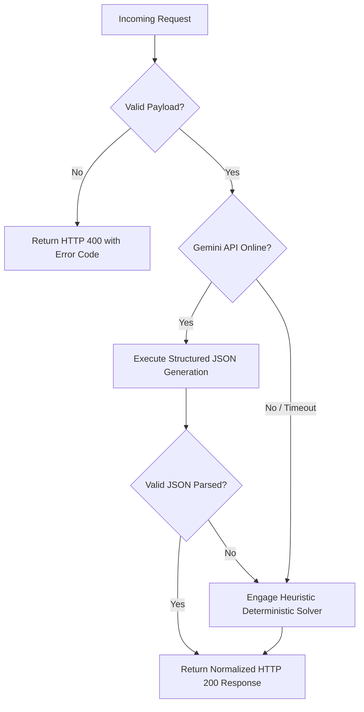

# EventGeniePlan AI - API Integration & Structured Output Guidelines

This guide details how EventGeniePlan AI connects Large Language Model (LLM) prompts with strictly enforced structured JSON outputs, enabling reliable, production-ready reading and writing of event data.

---

## 1. Architectural Principles

1. **Deterministic Contracts Over Freeform Text:**
   When an AI agent modifies event state (e.g., reallocating budget lines, flagging contract liabilities, or seating guests), the response **must adhere to a predefined JSON schema**. Freeform markdown is restricted to conversational summaries.
2. **Schema Enforcement via Gemini `responseMimeType`:**
   Google Gemini 2.5 Flash supports native JSON schema formatting using `responseMimeType: "application/json"`. This eliminates hallucinations or preamble text (e.g., *"Here is your JSON:"*).
3. **Resilient Local Fallback Engine:**
   If network outages, rate limits, or quota barriers occur, the service layer gracefully falls back to deterministic heuristic algorithms so the user experience is never interrupted.

---

## 2. Core JSON Schema Implementations

### A. Vendor Contract Analysis Schema
**Endpoint:** `POST /api/contracts/analyze`

#### System Instruction:
```
You are an event contract analyzer that outputs strictly valid JSON.
```

#### Prompt Specification:
```text
Analyze the following event contract text with forensic precision. Extract:
1. "riskScore": integer (0 to 100)
2. "riskLevel": "Low" | "Medium" | "High" | "Critical"
3. "summary": string
4. "hiddenFees": Array<{ "feeName": string, "amount": string, "trigger": string, "risk": "Medium"|"High" }>
5. "depositSchedule": Array<{ "milestone": string, "percentage": string, "deadline": string, "refundable": boolean, "notes": string }>
6. "redFlags": Array<string>
7. "actionableRecommendations": Array<string>

Return ONLY valid JSON.
```

#### Node.js Implementation Example:
```javascript
const { GoogleGenerativeAI } = require('@google/generative-ai');

async function analyzeContractWithGemini(contractText, apiKey) {
  const genAI = new GoogleGenerativeAI(apiKey);
  const model = genAI.getGenerativeModel({
    model: 'gemini-2.5-flash',
    generationConfig: {
      temperature: 0.2, // Low temperature for legal precision
      responseMimeType: 'application/json'
    }
  });

  const prompt = `Analyze this vendor agreement and output strict JSON:\n"""${contractText}"""`;
  const result = await model.generateContent(prompt);
  const response = await result.response;
  
  // Directly parse JSON without regex cleaning
  return JSON.parse(response.text());
}
```

---

### B. Seating Chart Optimizer Schema
**Endpoint:** `POST /api/seating/optimize`

#### JSON Schema Structure:
```json
{
  "tableAssignments": [
    {
      "tableId": "tbl_1",
      "tableName": "Table 1 - Head / VIP",
      "guestIds": ["gst_1", "gst_2", "gst_3"],
      "rationale": "Bridal party VIP cluster with zero friction conflicts."
    }
  ],
  "frictionConflictsResolved": 2,
  "dietaryClustersFormed": [
    "Table 2: 2x Vegan, 1x Halal",
    "Table 3: 2x Nut Allergy safe"
  ],
  "harmonyScore": 96
}
```

---

### C. Multi-Agent Copilot Tool Calling Pattern (LangChain / OpenAI Compatible)

If migrating from direct Gemini API to LangChain or OpenAI Function Calling:

```python
# Python LangChain / Pydantic Example
from pydantic import BaseModel, Field
from typing import List

class BudgetTransfer(BaseModel):
    from_category: str = Field(description="Category to deduct surplus from")
    to_category: str = Field(description="Deficit category receiving funds")
    amount: float = Field(description="Dollar amount to rebalance")
    reason: str = Field(description="Financial audit rationale")

class BudgetRedistributionPlan(BaseModel):
    is_overrun_detected: bool
    total_deficit: float
    transfers: List[BudgetTransfer]
    projected_health_score: int
    recommendation: str

# With OpenAI or Gemini LangChain wrapper:
# structured_llm = llm.with_structured_output(BudgetRedistributionPlan)
# plan = structured_llm.invoke("Venue rental exceeded by $500, rebalance budget.")
```

---

## 3. Error Handling & Validation Workflow


