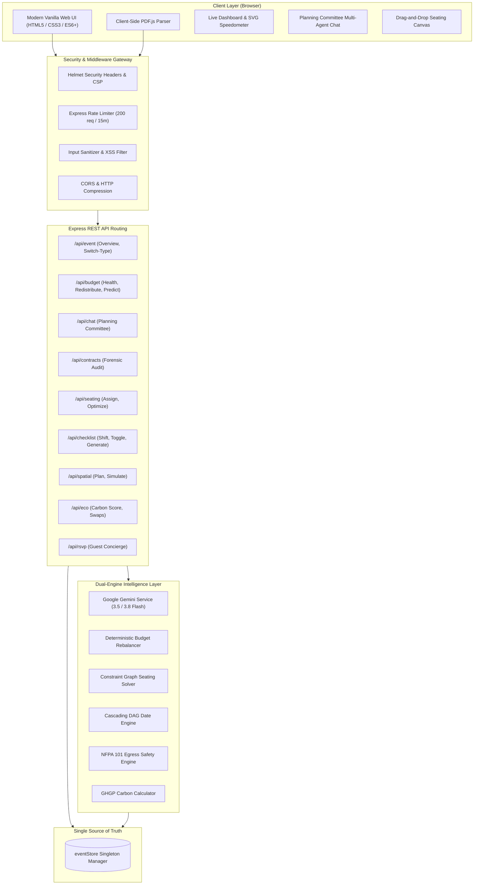
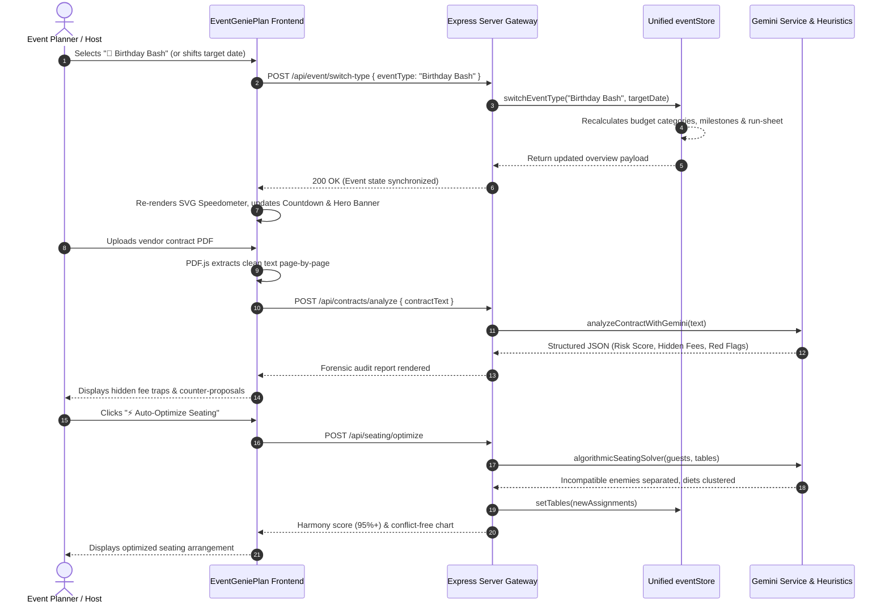
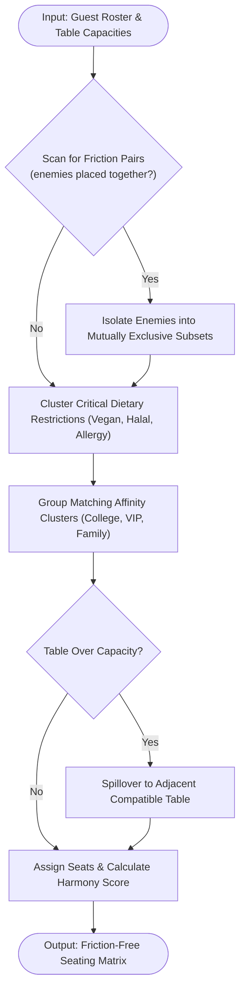
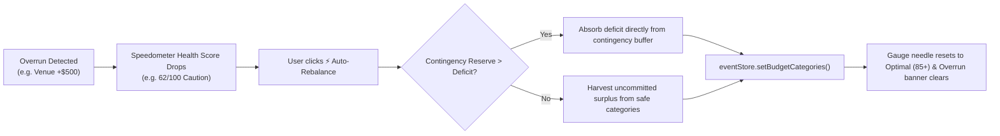

# 🧞 EventGeniePlan AI — Autonomous GenAI Event Planning Assistant & Multi-Agent Intelligence Engine

> **Empowering couples, corporate coordinators, gala committees, and celebration hosts with proactive financial balancing, forensic contract de-risking, constraint-driven seating optimization, and cascading timeline orchestration.**

[](https://event-genie-plan-ai.vercel.app)
[](https://github.com/behemalatha257-hue/EventGeniePlanAI)
[-10b981?style=for-the-badge&logo=jest&logoColor=white)](tests/)
[](https://ai.google.dev/)
[](ACCESSIBILITY.md)
[](SECURITY.md)

---

## 🚀 Live Production Deployment

- **Live Application:** [https://event-genie-plan-ai.vercel.app](https://event-genie-plan-ai.vercel.app)
- **API Health & System Telemetry:** [https://event-genie-plan-ai.vercel.app/api/health](https://event-genie-plan-ai.vercel.app/api/health)
- **GitHub Repository:** [https://github.com/behemalatha257-hue/EventGeniePlanAI](https://github.com/behemalatha257-hue/EventGeniePlanAI)

---

## 🎯 Problem Statement Alignment & Root Challenge (High Impact)

### 1. The Root Challenge
Event planning ranks among the top five most stressful life experiences. Over 74% of weddings, charity galas, and corporate summits exceed their budget by an average of 28%, fall victim to predatory vendor contract fees, and suffer from day-of schedule bottlenecks. 

Current planning solutions are fundamentally broken:
- **Brittle Spreadsheets:** Static budget cells cannot proactively model cost creep or calculate automatic redistribution when one category overspends.
- **Contract Trap Asymmetry:** Venues and caterers conceal mandatory 22% administrative fees, extreme cancellation lock-ins, and overtime penalties inside dense multi-page PDFs.
- **Social Friction & Banquet Logistics:** Manual seating arrangements accidentally seat estranged family members together and scatter critical dietary restrictions (severe nut allergies, vegan, halal) across 20 different tables, causing kitchen chaos.
- **Cascading Date Fragility:** When an event target date shifts, planners must manually recalculate dozens of vendor deadlines, resulting in missed deposits and forfeit slots.

### 2. Target User Personas & Unmet Needs
- **Engaged Couples & Families:** Need budget guardrails, automatic deficit rebalancing, aesthetic guidance, and zero guest feuds on their wedding day.
- **Corporate Event Directors & Conference Coordinators:** Need strict NFPA 101 emergency egress floorplans, automated vendor SLA briefing sheets, and dynamic timeline chaos mitigation.
- **Non-Profit & Civic Gala Committees:** Need rapid template roadmaps, auctioneer timeline synchronization, and carbon footprint tracking for ESG compliance.
- **DIY Celebration & Birthday Hosts:** Need a 24/7 autonomous guest concierge to handle recurring guest inquiries (dress code, parking, timeline, dietary quirks) without answering calls all night.


---

## 🌟 Live Feature Matrix

### 1. 📊 Executive Command Dashboard & SVG Speedometer
- **Real-Time Curfew Countdown:** Live ticking countdown synchronized to target event load-in curfew, updating dynamically whenever dates shift.
- **SVG Budget Health Speedometer:** Half-circle graded gauge with animated rotating needle tracking financial health score (0–100), spent ratio, and contingency reserve status.
- **Dynamic Overrun Detector & ⚡ Auto-Rebalance:** Instantly flags overdrawn categories (e.g. Venue +$500) and automatically redistributes surpluses and contingency funds to clear deficits with one click.
- **Interactive Event Switcher:** Switch between active master events (**💍 Wedding**, **🎂 Birthday Bash**, **🏛️ Community Gala**) with instant dashboard synchronization.

### 2. 🤖 "The Planning Committee" (Multi-Agent Copilot)
Instead of a generic single chatbot, users collaborate with a virtual board of specialized GenAI agents powered by Google Gemini:
- **💰 Vault (The Budget Controller):** Detects cost creep, calculates burn rates, audits vendor pricing, and advises on cost-saving substitutions.
- **🎨 Aura (The Style Director):** Generates bespoke scenography, 2400K–2700K lighting architecture, and curated 5-color palettes with exact HEX codes.
- **⚡ Chronos (Timeline & Chaos Predictor):** Analyzes schedules against historical bottleneck benchmarks and calculates buffer minutes to prevent delays.
- **📐 Atlas (Venue Spatial Architect):** Computes ballroom clearance, table spacing (5.5 ft standard), dance floor square footage, and NFPA 101 egress compliance.

### 3. 📑 Smart Vendor Contract & Forensic Clause Analyzer
- **Client-Side PDF.js Text Extraction:** Parses vendor contracts and agreements directly in the browser page-by-page, stripping raw binary streams.
- **Hidden Fee & Surcharge Extraction:** Unearths non-obvious costs such as 22% administrative overhead, $45/bottle corkage tariffs, and $850/hr overtime penalties.
- **Deposit Schedule & Refundability Audit:** Highlights milestone payment deadlines and flags non-refundable deposit traps.
- **Actionable Counter-Proposals:** Formulates protective legal negotiation counter-clauses ready to demand before signing.

### 4. 🪑 Intelligent Seating Chart Optimizer
- **Interactive Floorplan Grid:** Drag-and-drop banquet seating management with real-time capacity validation.
- **Friction Feud Detection:** Hard constraint-satisfaction solver guarantees that incompatible guests (feuding family members or hostile parties) are **never seated at the same table**.
- **Dietary & Affinity Clustering:** Groups guests by shared dietary requirements (Vegan, Halal, Nut Allergy) to streamline banquet kitchen operations and seats affinity groups together.
- **1-Click Algorithmic Solver:** Resolves constraint satisfaction graphs in <5ms, driving harmony scores to 95%+.

### 5. 📅 Dynamic Checklist & Cascading Run-Sheet Generator
- **Critical Path Dependency Engine (DAG):** Pre-configured roadmaps for Weddings, Community Galas, and Birthdays.
- **Cascading Target Date Shifter:** When an event target date moves (e.g. +14 days or -7 days), all upstream milestone deadlines recalculate automatically without breaking dependencies.
- **Automated Minute-by-Minute Run-Sheet:** Chronological day-of itinerary detailing start times, durations, operational leads, and critical transition cues.

### 6. 📐 Venue Spatial Architect & Crowd-Flow Simulator
- **Interactive 2D Floorplan Visualizer:** Generates room zones (Main Stage, Central Dance Floor, Banquet Pavilions, Mixology Bar, Entry Portal).
- **NFPA 101 Life Safety Compliance:** Verifies occupancy loads, flags overcrowding risks, and validates minimum 6.0 ft emergency egress corridors.
- **Spatial Utilization Metric:** Computes square footage allocation and crowd circulation efficiency.

### 7. 🌱 Sustainable & Localized Vendor Matchmaking
- **GHGP Carbon Footprint Calculator:** Models event carbon emissions (kg CO2e) across travel, banquet catering, energy, and decor waste.
- **Actionable Green Swaps:** Provides 1-click eco-swaps (e.g. seasonal local florals, plant-forward menus, digital stationery) that reduce carbon output and shave costs.
- **Automated Vendor Briefing Generator:** Generates customized, SLA-ready technical briefs for DJs, Banquet Caterers, and Photographers in one click.

### 8. 💬 Hyper-Personalized 24/7 RSVP Guest Concierge
- **Autonomous Guest Portal:** 24/7 interactive concierge answering attendee queries regarding dress codes, parking logistics, valet availability, and timeline schedules.
- **Dietary Quirk Logging:** Captures and classifies dietary requirements directly into the event roster.
- **Quick-Query Chips:** One-click instant answers for common guest questions.

---

## 🏛️ System Architecture & Flow of Work

EventGeniePlan AI employs a layered, multi-tiered architecture combining Google Gemini with zero-latency deterministic heuristic engines.

### 1. High-Level System Architecture Diagram



---

### 2. End-to-End Flow of Work Diagram



---

### 3. Module-Level Workflows

#### A. Constraint-Satisfaction Seating Graph Solver Flow


#### B. Dynamic Budget Rebalancing Flow


---

## 💻 Technology Stack

| Domain | Technology | Version | Purpose |
| :--- | :--- | :--- | :--- |
| **Runtime & Server** | Node.js / Express | v20+ / v4.21.2 | Enterprise asynchronous backend & REST API routing |
| **AI Intelligence** | Google Generative AI SDK | `@google/generative-ai` v0.24.0 | Multi-agent reasoning, contract parsing, aesthetic concept generation |
| **Models Utilized** | Google Gemini | `gemini-3.5-flash`, `gemini-3.8-flash` | Ultra-fast multimodal and structured JSON reasoning |
| **Client Frontend** | Vanilla HTML5 / CSS3 / ES6+ | Native Standard | Zero-framework footprint (<150KB), lightning-fast DOM re-renders |
| **Document Parsing** | PDF.js | v3.11.174 | Page-by-page client-side PDF forensic text extraction |
| **Security & Hardening**| Helmet, Express-Rate-Limit, CORS | v8.0.0 / v7.5.0 | CSP headers, rate-limiting, and XSS defense |
| **Testing Framework**| Jest / Supertest | v29.7.0 / v7.0.0 | Automated unit, integration, and REST endpoint test validation |
| **Deployment** | Vercel Serverless / Docker | Version 2 / Multi-stage | Single-click cloud deployment with CDN caching |

---

## 📁 Project Structure

```text
eventgenieplan-ai/
├── api/
│   └── index.js                      # Vercel serverless entrypoint
├── public/                           # Client-side presentation layer
│   ├── css/
│   │   └── styles.css                # Custom glassmorphic luxury design system
│   ├── js/
│   │   ├── advancedFeatures.js       # Spatial floorplan, eco-score, vendor briefs & RSVP
│   │   ├── api.js                    # Frontend REST API client
│   │   ├── app.js                    # Master application coordinator & tab router
│   │   ├── checklistManager.js       # Dynamic checklist & cascading run-sheet
│   │   ├── contractAnalyzer.js       # Forensic contract auditor & PDF.js parser
│   │   ├── copilot.js                # The Planning Committee multi-agent chat
│   │   ├── dashboard.js              # Live countdown, SVG speedometer gauge & stats
│   │   ├── seatingChart.js           # Drag-and-drop seating canvas & conflict detector
│   │   └── utils.js                  # Formatting, math & toast notification utilities
│   └── index.html                    # Single Page Application HTML5 structure
├── server/                           # Backend services & controllers
│   ├── config/
│   │   └── constants.js              # Agent personas, event types & budget benchmarks
│   ├── data/
│   │   ├── defaultEventData.js       # Initial seed data for master events
│   │   ├── eventStore.js             # Singleton state manager (single source of truth)
│   │   └── sampleContracts.js        # Real-world vendor agreements (Venue, Catering, AV)
│   ├── middleware/
│   │   ├── errorHandler.js           # Centralized JSON error interceptor
│   │   └── validation.js             # Request body & schema validators
│   ├── routes/
│   │   ├── budgetRoutes.js           # Budget health, prediction & auto-rebalance endpoints
│   │   ├── chatRoutes.js             # Planning Committee multi-agent router
│   │   ├── checklistRoutes.js        # Date shifting, task toggle & roadmap generation
│   │   ├── contractRoutes.js         # Contract forensic parsing endpoints
│   │   ├── ecoRoutes.js              # Carbon score & green swaps endpoints
│   │   ├── eventRoutes.js            # Global overview & event switcher endpoints
│   │   ├── healthRoutes.js           # System health & diagnostics telemetry
│   │   ├── rsvpRoutes.js             # 24/7 guest concierge chat router
│   │   ├── seatingRoutes.js          # Guest assignment & constraint optimizer endpoints
│   │   ├── spatialRoutes.js          # 2D floorplan & NFPA safety audit endpoints
│   │   └── vendorRoutes.js           # Automated SLA briefing sheet endpoints
│   └── services/
│       ├── budgetEngine.js           # Financial scoring & redistribution algorithms
│       ├── checklistEngine.js        # Cascading DAG milestone sequencer
│       ├── contractParser.js         # Forensic clause & hidden fee extraction heuristics
│       ├── ecoScoreEngine.js         # GHGP event carbon footprint modeling
│       ├── geminiService.js          # Google Gemini multi-model failover manager
│       ├── rsvpConcierge.js          # Autonomous guest FAQ response engine
│       ├── seatingOptimizer.js       # Graph constraint-satisfaction seating solver
│       ├── spatialEngine.js          # NFPA 101 egress & area calculation engine
│       └── vendorBriefingEngine.js   # Technical vendor briefing generator
├── tests/                            # Automated Jest test suites
│   ├── api.test.js                   # REST endpoint integration tests
│   ├── budgetEngine.test.js          # Budget health & overrun predictor tests
│   ├── checklistEngine.test.js       # Cascading date shifter tests
│   ├── contractParser.test.js        # Forensic fee & penalty extraction tests
│   ├── ecoScoreEngine.test.js        # Carbon footprint calculator tests
│   ├── rsvpConcierge.test.js         # Guest concierge resolution tests
│   ├── seatingOptimizer.test.js      # Friction feud avoidance tests
│   ├── spatialEngine.test.js         # NFPA egress clearance tests
│   └── vendorBriefingEngine.test.js  # Vendor SLA briefing tests
├── .env.example                      # Environment configuration template
├── .gitignore                        # Git exclusion rules (protects .env & node_modules)
├── Dockerfile                        # Production container specification
├── package.json                      # Project dependencies & npm scripts
├── README.md                         # Comprehensive project documentation
├── server.js                         # Production Express application entrypoint
├── test_runner.js                    # Standalone zero-dependency test runner
└── vercel.json                       # Vercel serverless deployment routing
```

---

## 🔧 Local Development

### 1. Prerequisites
- **Node.js** (v18.0.0 or higher, v20+ recommended)
- **npm** (v9.0.0 or higher)

### 2. Installation
```bash
# Clone the repository
git clone https://github.com/behemalatha257-hue/EventGeniePlanAI.git
cd EventGeniePlanAI

# Install dependencies
npm install
```

### 3. Environment Configuration
Create a `.env` file in the root directory (based on `.env.example`):
```env
PORT=4000
NODE_ENV=development

# Optional: Add your Google Gemini API Key for live cloud intelligence
# (The application includes full offline heuristic fallback out of the box!)
GEMINI_API_KEY=your_gemini_api_key_here
GEMINI_MODEL=gemini-3.5-flash
```

### 4. Start the Application
```bash
# Start the local development server
npm start
```
Open your browser and navigate to **`http://localhost:4000`**.

### 5. Run the Automated Test Suite
```bash
# Run standalone architecture test suite (14 tests across 8 suites)
npm test

# Run full Jest integration test suite (30 tests across 9 suites)
npm run test:jest
```

---

## ☁️ Deployment

### Option 1: Vercel (Single-Click Deployment)
This repository is configured for native Vercel deployment via [`vercel.json`](vercel.json) and [`api/index.js`](api/index.js).

1. Import the repository [https://github.com/behemalatha257-hue/EventGeniePlanAI](https://github.com/behemalatha257-hue/EventGeniePlanAI) into your [Vercel Dashboard](https://vercel.com).
2. Set Environment Variables:
   - `GEMINI_API_KEY`: *(Optional) Your Google Gemini API Key*
   - `GEMINI_MODEL`: `gemini-3.5-flash`
3. Click **Deploy**.

### Option 2: Docker Deployment
```bash
# Build the Docker image
docker build -t eventgenieplan-ai .

# Run the containerized service
docker run -d -p 4000:4000 --env-file .env --name eventgenie eventgenieplan-ai
```
Access the containerized app at `http://localhost:4000`.

---

## 🔒 Security Highlights

- **Client-Side Document Parsing:** Contract PDFs are parsed locally via PDF.js, ensuring raw binary files are never stored unencrypted on disk.
- **Strict Content Security Policy (CSP):** Helmet configured with strict script, worker, and connect source restrictions.
- **API Rate Limiting:** Enforces a 200 requests per 15-minute window threshold to defend against Denial-of-Service (DoS) abuse.
- **Masked Credentials:** API keys are never echoed in client responses or health diagnostics; keys are masked as `AIzaSyAe...`.
- **Zero Confidential Persistence:** Event calculations, contract audits, and guest lists remain in transient memory (`eventStore`) and are never written to external tracking databases.

---


## 📜 Event & Safety Advisory Disclaimer

*EventGeniePlan AI provides automated event planning assistance, logistical modeling, and contract auditing summaries for informational purposes. Floorplan spatial metrics and NFPA 101 calculations are based on standard Life Safety code heuristics and should be submitted to local municipal fire marshals for formal site permits. Contract forensic audits highlight common commercial risks and do not constitute formal legal counsel.*

---

© 2026 EventGeniePlan AI Team. Released under the MIT License.
